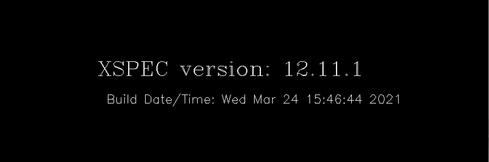
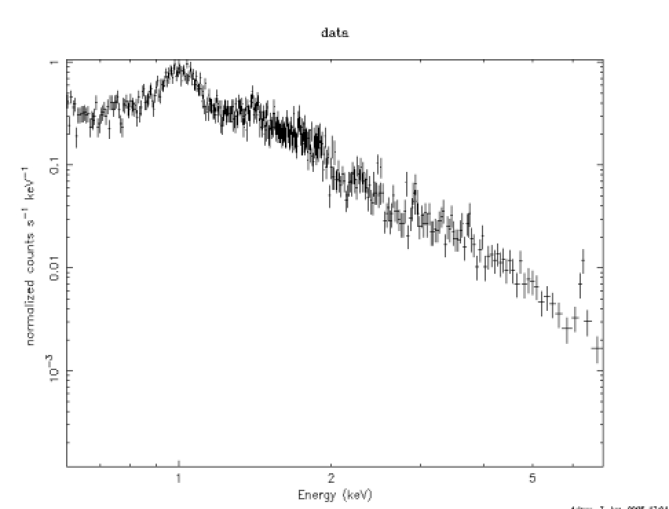
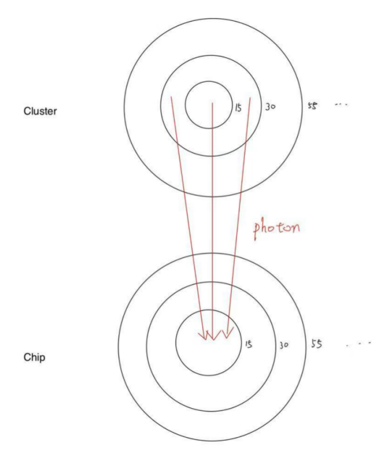
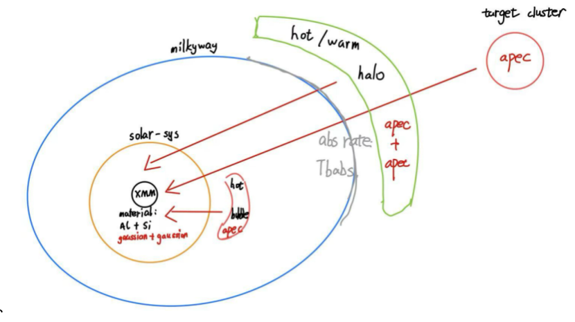
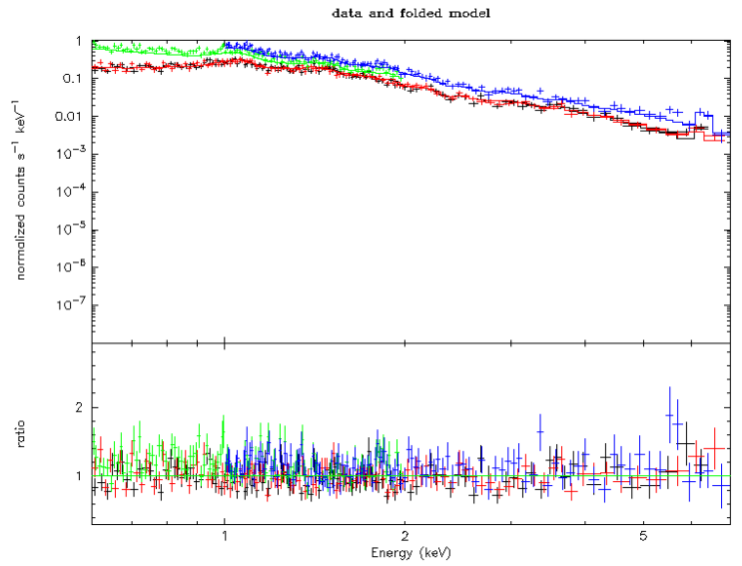

# XSPEC Instruction

A practical guide to loading X-ray spectra, configuring models, and running fits
in XSPEC through the University of Michigan Lang environment.

**Workflow:** prepare access → connect to Lang → start XSPEC → load spectra and
responses → configure a model → fit → inspect and adjust parameters.

## Contents

1. [Introduction and preparation](#introduction-and-preparation)
2. [Environment setup](#environment-setup)
3. [Starting XSPEC](#starting-xspec)
4. [Loading and plotting spectra](#loading-and-plotting-spectra)
5. [Understanding XCM files](#understanding-xcm-files)
   - [5.1 Spectra and fitting ranges](#spectra-and-fitting-ranges)
   - [5.2 Response files](#response-files)
   - [5.3 Fitting settings](#fitting-settings)
   - [5.4 Model components and parameters](#model-components-and-parameters)
6. [Running a fit](#running-a-fit)
7. [Inspecting and adjusting parameters](#inspecting-and-adjusting-parameters)

[Command quick reference](#command-quick-reference) · [Further reading](#further-reading)

## Introduction and preparation

XSPEC is a spectral-fitting tool for analyzing astronomical X-ray data. This
guide uses the Lang server, where project spectra, response files, backgrounds,
and model scripts are stored alongside an existing XSPEC installation.

### Before you connect

| Preparation | Resource |
|---|---|
| Request a Lang account and project directory | [LSA Technology Services](mailto:LSATechnologyServices@umich.edu) |
| Install XQuartz for the macOS X11 display used in these examples | [XQuartz](https://www.xquartz.org/) |
| Install the image viewer used by the project | [SAOImage DS9 downloads](https://sites.google.com/cfa.harvard.edu/saoimageds9/download) |
| Connect through the U-M network or VPN | [U-M secure connection guidance](https://safecomputing.umich.edu/protect-yourself/be-safe-online/secure-connection) |

### Where to enter commands

| Location | What belongs there |
|---|---|
| **Local terminal** | SSH login and `scp` file transfers |
| **Lang terminal** | Directory navigation, `heainit`, and launching `xspec` |
| **XSPEC prompt** (`XSPEC12>`) | Spectrum loading, model configuration, fitting, and parameter commands |

Commands below are shown without terminal prompts so they can be copied directly.
Blocks labeled **Example output** are transcripts, not commands to enter.
Replace `your_uniquename` and placeholder paths with your own account and files.
The sample XSPEC output was recorded with version **12.11.1**.

## Environment setup

### Connect to Lang

In your **local terminal**:

```bash
ssh -XY your_uniquename@lang-sas-vm.astro.lsa.umich.edu
```

Complete the SSH login prompts. You are then working in the remote Lang terminal.

### Open your project directory

In the **Lang terminal**:

```bash
cd /nfs/Lang2/your_uniquename/
ls
```

Use these navigation commands to move between directories:

| Command | Purpose |
|---|---|
| `cd a1991/` | Enter the `a1991` directory |
| `cd ..` | Move to the parent directory |
| `ls` | List files and directories |

### Transfer files

Run `scp` from a **separate local terminal**, outside the SSH session.

**Lang → your laptop**

```bash
scp -r your_uniquename@lang-sas-vm.astro.lsa.umich.edu:/path/to/directory/file /path/on/your/computer/
```

**Your laptop → Lang**

```bash
scp -r /path/on/your/computer/file your_uniquename@lang-sas-vm.astro.lsa.umich.edu:/path/to/directory/
```

## Starting XSPEC

In the **Lang terminal**, initialize HEASoft if your login environment requires it,
then start XSPEC:

```bash
heainit
xspec
```

**Example output**

```text
XSPEC version: 12.11.1
Build Date/Time: Wed Mar 24 15:46:44 2021

XSPEC12>
```

The `XSPEC12>` prompt indicates that you can now enter XSPEC commands.

## Loading and plotting spectra

### Load spectra

At the **XSPEC prompt**:

```text
data 1:1 mos1S001-obj-15-grp15.pi
data 2:2 mos2U002-obj-15-grp15.pi
```

**Example output after loading the second spectrum**

```text
2 spectra in use
Spectral Data File: mos2U002-obj-15-grp15.pi  Spectrum 2
...
```

### Select the fitting ranges

The examples below retain different energy ranges for spectra 1 and 2:

```text
ignore 1:0-0.6,7.0-**
ignore 2:0-0.2,1-**
```

XSPEC reports the ignored channels for each spectrum. These ranges are the
original tutorial examples; use the ranges specified for your own analysis.

### Open the plotting window

```text
cpd /xs
```



*The plotting window opened through the X11 display.*

### Plot spectra against energy

```text
setplot energy
plot ld
```



*Example spectrum display after setting the horizontal axis to energy.*

When multiple spectra are loaded, they can appear in the same plot. In the
illustrated plotting setup, the first four spectra use black, red, green, and
blue respectively.

## Understanding XCM files

An `.xcm` file is an XSPEC command script. It can record data-loading commands,
response assignments, model definitions, parameter values, and fitting settings.
An example filename is `0-15_apec.xcm`.

A typical script in this project contains four sections:

| Section | Contents |
|---|---|
| [5.1 Spectra and fitting ranges](#spectra-and-fitting-ranges) | Data files and ignored channels |
| [5.2 Response files](#response-files) | RMF, ARF, and other response assignments |
| [5.3 Fitting settings](#fitting-settings) | Statistic, optimizer, abundance standard, and related settings |
| [5.4 Model components and parameters](#model-components-and-parameters) | Model expression and parameter records |

### Spectra and fitting ranges

```text
data 1:1 mos1S001-obj-15-grp15.pi
data 2:2 mos2U002-obj-15-grp15.pi
data 3:3 pnS003-obj-os-15-soft-grp15.pi
data 4:4 pnS003-obj-os-15-hard-grp15.pi
ignore 1:0-0.6,7-**
```

Additional spectra and range selections follow the same pattern.

### Response files

```text
response 2:1 mos1-diag.rsp.gz
response 14:1 mos1S001-15.rmf
arf 1:1 mos1S001-0-15-0-15.arf
arf 14:1 mos1S001-15-30-0-15.arf
```

These assignments are retained from the original multi-response example for
spectrum 1; the response identifiers belong to that example's model setup.

| File type | Role |
|---|---|
| **RMF** — Redistribution Matrix File | Describes how incident photon energies are redistributed into detector channels |
| **ARF** — Ancillary Response File | Describes the effective collecting area as a function of energy |
| **RSP** — response matrix | Can contain a combined RMF × ARF response; `.gz` indicates compression |

The file extension alone does not establish response accuracy or suitability.
See the [HEASARC explanation of RMF, ARF, and combined RSP files](https://heasarc.gsfc.nasa.gov/docs/asca/abc/node9.html).



*Illustration accompanying the original response-file discussion.*

### Fitting settings

```text
statistic chi
method leven 5000 0.01
abund aspl
xsect bcmc
cosmo 70 0 0.73
xset delta -1
systematic 0
```

These are the original example settings. They specify the statistic, fitting
method, abundance standard, absorption cross-sections, cosmology, and related
modeling options.

### Model components and parameters

Enter `model`, then supply the model expression when XSPEC requests it:

```text
model
```

**Original example model expression**

```text
gaussian + gaussian + constant*constant(gaussian + gaussian + apec + (apec + apec + powerlaw)TBabs + apec*TBabs)
```

This is the original cluster-model example. The components and parameter values
below illustrate its structure rather than a universal model configuration.

| Component | Purpose | Parameters shown here |
|---|---|---|
| `gaussian` | Represent a spectral line | `LineE`, `Sigma`, `norm` |
| `apec` | Describe emission from hot, collisionally ionized plasma | `kT`, abundance, redshift, `norm` |
| `TBabs` | Describe photoelectric absorption | `nH` |

The parameter records below retain their original numerical values. The six
columns are `value`, `delta`, hard minimum, soft minimum, soft maximum, and hard
maximum. See the [XSPEC parameter specification](https://heasarc.gsfc.nasa.gov/docs/software/xspec/manual/node138.html).

**Gaussian parameter records**

Rows correspond to `LineE` (keV), `Sigma` (keV), and `norm`, in that order.

```text
1.496        -0.05          0          0      1e+06      1e+06
3.74266       0.05          0          0         10         20
0.000209406   0.01          0          0      1e+24      1e+24
```

**APEC parameter records**

Rows correspond to `kT` (keV), abundance relative to solar, redshift, and `norm`.

```text
1       -0.01          0          0      1e+10      1e+10
2.226   -0.01          0          0      1e+10      1e+10
0.56    -0.05          0          0      1e+06      1e+06
0       -0.05          0          0         10         20
```

**TBabs parameter record**

The row below specifies `nH`; it is fixed in this example.

```text
0.0288      -0.01          0          0         10         10
```



*Example model and parameter display from the original guide.*

In this cluster example, the model combines source emission, local and Galactic
foreground/background emission, absorption, and instrumental line components.
The constant factors provide the scaling used by the original model setup.

## Running a fit

### Load an XCM script

You can enter the script's commands individually, or load the script at the
**XSPEC prompt**:

```text
@0-15vapec.xcm
```

**Example output from the original session, before fitting**

```text
Test statistic : Chi-Squared                 3218.96     using 2415 bins.
Null hypothesis probability of 5.96e-30 with 2356 degrees of freedom
Current data and model not fit yet.
```

### Run the fit

```text
fit 5000
```

This requests up to 5000 fitting iterations. You can also use `fit` with the
current fitting settings. Inspect the resulting fit information and plots before
making further parameter adjustments.

## Inspecting and adjusting parameters

All commands in this section are entered at the **XSPEC prompt**. Parameter
indices refer to the currently loaded model.

### Show the model parameters

```text
show par
```

**Example output**

```text
Parameters defined:
========================================================================
Model gaussian<1> + gaussian<2> + constant<3>*constant<4>(gaussian<5> + gaussian<6> + apec<7> + (apec<8> + apec<9> + powerlaw<10>)TBabs<11> + vapec<12>*TBabs<13>) Source No.: 1   Active/On
...
```

### Freeze or thaw a parameter

**Keep parameter 2 fixed during fitting**

```text
freeze 2
```

**Allow parameter 2 to vary again**

```text
thaw 2
```

### Change a parameter value

**Set parameter 2 to a value of 1**

```text
newpar 2 1
```

### Plot data and the data/model ratio

```text
plot ld rat
```



*The upper panel displays the spectrum; the lower panel displays the data/model ratio.*

## Command quick reference

| Where | Command | Purpose |
|---|---|---|
| Local terminal | `ssh -XY your_uniquename@lang-sas-vm.astro.lsa.umich.edu` | Connect to Lang with X11 forwarding |
| Local terminal | `scp -r source destination` | Transfer files or directories |
| Lang terminal | `cd`, `cd ..`, `ls` | Navigate the project files |
| Lang terminal | `heainit` | Initialize the project's HEASoft environment when required |
| Lang terminal | `xspec` | Start XSPEC |
| XSPEC | `data 1:1 spectrum.pi` | Load a spectrum |
| XSPEC | `ignore 1:0-0.6,7.0-**` | Apply the example energy-range selection |
| XSPEC | `cpd /xs` | Open the plotting window |
| XSPEC | `setplot energy` | Use energy on the plot's horizontal axis |
| XSPEC | `plot ld` | Display the spectra |
| XSPEC | `@0-15vapec.xcm` | Read the example XCM script |
| XSPEC | `fit 5000` | Run fitting with the specified iteration limit |
| XSPEC | `show par` | Display model parameters |
| XSPEC | `freeze 2` / `thaw 2` | Fix or release parameter 2 |
| XSPEC | `newpar 2 1` | Set parameter 2 to a value of 1 |
| XSPEC | `plot ld rat` | Show spectra and the data/model ratio |

## Further reading

- [XSPEC user manual](https://heasarc.gsfc.nasa.gov/docs/software/xspec/manual/)
- [XSPEC model reference](https://heasarc.gsfc.nasa.gov/xanadu/xspec/manual/Models.html)
- [XSPEC command summary](https://heasarc.gsfc.nasa.gov/docs/software/xspec/manual/node72.html)
